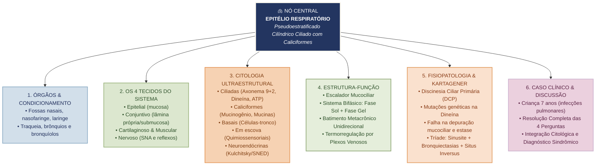

# Mapa Mental Ilustrado: Histologia do Sistema Respiratório

> **Autoria do Trabalho**: Nicole Vaz, Júlia Maina, Laura Almeida, Eloyse, Maria Luiza Senna, Fernanda Massaro e Roger Pacheco  
> **Componente**: Histologia Médica / Ciências da Saúde (2º Período)  
> **Tema Central**: Organização Tecidual, Citologia do Epitélio Respiratório, Mecanismo de Depuração Mucociliar e Aplicação Clínica (Síndrome de Kartagener)

---

## 🎨 Identidade Visual e Paleta de Cores (Estilo Canva / Slide 11)

| Elemento Visual | Código Hexadecimal | Função Didática / Aplicação no Mapa |
| :--- | :--- | :--- |
| **Moldura Externa** | `#CFDDE4` | Fundo pastel azul acinzentado suave que emoldura o slide 16:9 |
| **Prancha Central** | `#FAF7EE` | Fundo creme/marfim com cantos arredondados ($R=44\text{px}$) |
| **Azul Marinho Principal** | `#233560` | Títulos principais ("mapa mental"), eixos centrais e contraste forte |
| **Ocre / Terracota Orgânico**| `#E7A469` | Doodles curvilíneos tipo "impressão digital", células caliciformes e fase gel |
| **Verde Sálvia / Oliva** | `#9DB580` / `#DCE7CF` | Doodles inferiores, módulo dos 4 tecidos e células basais |
| **Azul Céu Pastel** | `#D2DFEA` | Módulo 1 (Órgãos e Vias Aéreas) e Fase Sol do muco periciliar |
| **Pêssego / Salmão Claro** | `#F6D2B3` | Módulo 3 (Citologia e Tipos Celulares) |
| **Coral Terracota Claro** | `#FAE1CE` | Módulo 5 (Fisiopatologia, Dineína e Síndrome de Kartagener) |
| **Lavanda / Malva Pastel** | `#EBD0DE` | Módulo 6 (Caso Clínico e Resoluções das 4 Questões) |

---

## 🗺️ Estrutura Hierárquica do Mapa Mental (Ramo a Ramo)

---

## 🔬 Detalhamento Técnico-Histológico dos Módulos

### Módulo 1: Órgãos e Vias de Condição do Ar
*Ref: Junqueira e Carneiro (2023); Tortora e Derrickson (2023)*
- **Fossas Nasais**:
  - Região vestibular com vibrissas (barreira mecânica macroscópica).
  - Região respiratória ricamente vascularizada (conchas nasais) provocando fluxo turbilhonar para retenção de micropartículas, aquecimento e saturação de vapor d'água.
- **Nasofaringe**:
  - Condução contínua do fluxo aéreo; revestida pelo epitélio respiratório e abrigando agregados linfoides (tonsila faríngea).
- **Laringe**:
  - Tubo irregular sustentado por cartilagens hialinas (tireóidea, cricóidea e aritenóideas) e elástica (epiglote).
  - Participa da fonação: pregas vocais verdadeiras revestidas por epitélio estratificado pavimentoso não queratinizado para resistir ao estresse mecânico de vibração.
- **Traqueia**:
  - Estrutura condutora flexível sustentada por 16 a 20 anéis em formato de "C" de cartilagem hialina.
  - Extremidades posteriores unidas pelo ligamento fibroelástico e feixes do músculo traqueal (liso).
- **Árvore Brônquica e Bronquíolos**:
  - Transição gradual: diminuição das placas cartilaginosas e aumento proporcional relativo de músculo liso e fibras elásticas.
  - Nos bronquíolos terminais e respiratórios, o epitélio transiciona para simples colunar e cúbico ciliado, com aparecimento de células club (exócrinas bronquiolares).

---

### Módulo 2: A Organização dos 4 Tecidos Fundamentais
*Ref: Junqueira e Carneiro (2023); Tortora e Derrickson (2023)*
1. **Tecido Epitelial (Mucosa)**:
   - Epitélio pseudoestratificado colunar ciliado com células caliciformes.
   - Atua como barreira física seletiva primária, impedindo a passagem paracelular de macromoléculas através de complexos juncionais apicais (*zonulae occludentes*, aderentes e desmossomos).
2. **Tecido Conjuntivo (Lâmina Própria e Submucosa)**:
   - *Lâmina Própria*: Conjuntivo frouxo com abundância de fibras elásticas, células de defesa (linfócitos, macrófagos, plasmócitos secretores de IgA) e plexos venosos profundos organizados como radiadores biológicos de contracorrente.
   - *Submucosa*: Conjuntivo denso contendo glândulas seromucosas mistas que secretam lisozima, lactoferrina e mucinas adicionais.
3. **Tecidos Cartilaginoso e Muscular**:
   - *Cartilagem Hialina*: Condrócitos em grupos isógenos imersos em matriz rica em colágeno tipo II e agrecano sulfatado; fornece suporte mecânico semirrígido indispensável para evitar o colapso luminal durante a expiração forçada.
   - *Músculo Liso (Músculo Traqueal e Músculo de Reisseisen)*: Feixes espiralados involuntários reguladores do calibre luminal da via aérea.
4. **Tecido Nervoso (Inervação Autônoma e Reflexos de Proteção)**:
   - Terminações nervosas livres sensitivas acopladas a receptores de irritação epiteliais deflagram os reflexos protetores de tosse e espirro.
   - Divisão Parassimpática (Nervo Vago / Acetilcolina): Promove broncoconstrição e hipersecreção glandular.
   - Divisão Simpática (Noradrenalina / Receptores $\beta_2$-adrenérgicos): Promove broncodilatação e relaxamento muscular liso.

---

### Módulo 3: Citologia Ultraestrutural do Epitélio Respiratório
*Ref: Junqueira e Carneiro (2013, 2023); Ross e Pawlina (2016)*
1. **Células Ciliadas (aprox. 30% da população celular)**:
   - Cilíndricas altas, cada uma exibindo entre 200 e 300 cílios móveis na borda apical.
   - **Ultraestrutura do Axonema**: Arranjo característico de $9\text{ dupletos periféricos} + 1\text{ par central}$ de microtúbulos.
   - **Motores Moleculares**: Braços de dineína ciliar (externos e internos) ancorados ao sub-túbulo A, que interagem ciclicamente com o sub-túbulo B vizinho consumindo ATP para gerar deslizamento e flexão ciliar.
   - Corpúsculos basais alinhados logo abaixo da membrana plasmática apical fornecem ancoragem citoesquelética aos microtúbulos.
2. **Células Caliciformes (aprox. 30% da população)**:
   - Células secretoras mucosas intraepiteliais em formato de cálice.
   - Base afilada repousando sobre a lâmina basal contendo o núcleo denso, RER bem desenvolvido e complexo de Golgi supranuclear.
   - Ápice distendido repleto de volumosos grânulos de mucinogênio ricos em glicoproteínas polianiônicas sulfatadas que sofrem exocitose contínua e rápida hidratação extracellular para formar muco.
3. **Células Basais (aprox. 30% da população)**:
   - Células piramidais pequenas situadas na base epitelial; seus núcleos formam a fileira inferior alinhada.
   - Atuam como células-tronco multipotentes somáticas de renovação tecidual contínua, com capacidade mitótica para regenerar tanto células ciliadas quanto caliciformes danificadas.
4. **Células em Escova (Brush Cells, aprox. 3%)**:
   - Células colunares delgadas portadoras de microvilosidades apicais rígidas, longas e espessas com feixes densos de actina.
   - Atuam como receptores quimiossensoriais de irritantes químicos e toxinas, estabelecendo sinapses com fibras nervosas aferentes sensitivas.
5. **Células Neuroendócrinas (Células de Kulchitsky / SNED, aprox. 3 a 4%)**:
   - Contêm grânulos basais de centro denso com serotonina, bombesina e calcitonina.
   - Podem agrupar-se em corpos neuroepiteliais inervados, atuando como sensores de níveis de oxigênio e dióxido de carbono luminal para modular tônus vascular e muscular local.

---

### Módulo 4: Relação Estrutura-Função (O Escalador Mucociliar)
*Ref: Junqueira e Carneiro (2017); Ross e Pawlina (2016)*
- **Sistema Bifásico de Muco (Camada Dupla Protetora)**:
  - **Fase Sol (Líquido Periciliar)**: Camada aquosa de baixa viscosidade produzida pelo transporte ativo de íons e água, que banha diretamente o comprimento das hastes ciliares, permitindo batimento com mínimo atrito mecânico.
  - **Fase Gel (Muco Viscoso Superficial)**: Manta gelatinosa espessa sobrejacente produzida pelas células caliciformes e glândulas submucosas; funciona como filme adesivo retentor de poeiras, poluentes e microrganismos.
- **Batimento Ciliar Metacrônico**:
  - Onda rítmica coordenada na qual cada cílio bate ligeiramente defasado em relação ao vizinho.
  - O golpe efetivo rápido impulsiona o muco na ponta dos cílios em direção à faringe a uma velocidade de até $1\text{ a }2\text{ cm/min}$, seguido por um movimento de recuperação lento e flexionado dentro da fase sol.
- **Integração com a Lâmina Própria**:
  - Plexos venosos intumescentes atuam como radiadores térmicos, evitando choque hipotérmico nas células alveolares profundas.
  - Glândulas seromucosas tubuloacinosas saturam o ar inspirado com umidade relativa de 100%.

---

### Módulo 5: Fisiopatologia da Discinesia Ciliar Primária & Síndrome de Kartagener
*Ref: Ross e Pawlina (2016); Tortora e Derrickson (2023)*
- **Discinesia Ciliar Primária (DCP)**:
  - Doença genética autossômica recessiva caracterizada por anormalidades ultraestruturais dos cílios móveis.
  - **Mecanismo Molecular**: Mutações em genes codificadores dos **braços de dineína interna e externa** (cadeias pesadas e intermediárias de dineína ciliar com atividade de ATPase motora).
  - Sem dineína funcional, os microtúbulos periféricos não deslizam: os cílios tornam-se completamente imóveis ou apresentam batimento assincrônico e caótico.
  - Consequência: Bloqueio da depuração mucociliar $\rightarrow$ acúmulo de secreções estagnadas $\rightarrow$ proliferação e biofilme bacteriano $\rightarrow$ infecções respiratórias crônicas destrutivas.
- **Tríade Clássica da Síndrome de Kartagener**:
  1. **Sinusite Crônica (Pansinusite e Otite Média)**: Retenção mucopurulenta nos seios da face e tuba auditiva.
  2. **Bronquiectasias**: Dilatações e deformidades irreversíveis da árvore brônquica causadas por ciclos repetidos de pneumonia e inflamação necrosante.
  3. **Situs Inversus Totalis**: Inversão especular dos órgãos viscerais (dextrocardia, fígado à esquerda, estômago à direita) resultante da ausência de rotação ciliar no nódulo embrionário primitivo durante a determinação da lateralidade embriológica.

---

### Módulo 6: Caso Clínico Pediátrico & Discussão (Slides 8 e 9)
*Ref: Junqueira e Carneiro (2023); Ross e Pawlina (2016)*

**História Clínica**:
> *"Uma criança de 7 anos apresenta episódios frequentes de sinusite, tosse persistente com secreção e infecções pulmonares recorrentes desde os primeiros meses de vida. Após avaliação médica, foi identificada uma alteração genética que compromete os braços de dineína dos cílios do epitélio respiratório."*

**Gabarito Acadêmico Fundamentado**:
1. **Qual é a função das células ciliadas e das células caliciformes no epitélio respiratório?**  
   *Resposta*: As células caliciformes secretam mucinas glicoproteicas hidratadas que formam o muco adesivo da fase gel, cuja função é aprisionar patógenos, alérgenos e partículas inaladas. As células ciliadas realizam batimentos rítmicos, sincronizados e metacrônicos na fase sol, propulsionando unidirecionalmente a manta mucosa carregada de impurezas até a faringe para deglutição ou expectoração.
2. **Como o defeito nos braços de dineína interfere na limpeza das vias respiratórias?**  
   *Resposta*: Os braços de dineína externa e interna são motores moleculares dependentes de ATP responsáveis por gerar a força mecânica de deslizamento relativo entre os dupletos periféricos de microtúbulos do axonema. O defeito na dineína suprime ou descoordena o batimento ciliar, paralisando o escalador mucociliar e impedindo a expulsão física do muco contaminado.
3. **Por que essa alteração favorece infecções respiratórias recorrentes?**  
   *Resposta*: Sem a depuração mucociliar ativa, o muco espesso fica retido e estagnado nas vias aéreas superiores e inferiores. Esse ambiente quente, úmido e rico em nutrientes converte-se em meio de cultura ideal para colonização, fixação bacteriana e formação de biofilmes patogênicos recorrentes.
4. **Qual doença pode estar relacionada ao quadro clínico apresentado?**  
   *Resposta*: Trata-se de **Discinesia Ciliar Primária (DCP)** (Síndrome dos Cílios Imóveis), que em conjunto com *situs inversus* e bronquiectasias constitui a **Síndrome de Kartagener**.

---

## 📚 Referências Bibliográficas Normativas Exclusivas

1. **JUNQUEIRA, Luiz Carlos Uchoa; CARNEIRO, José.** *Histologia básica: texto e atlas*. 12. ed. Rio de Janeiro: Guanabara Koogan, 2013.
2. **JUNQUEIRA, Luiz Carlos Uchoa; CARNEIRO, José.** *Histologia básica: texto e atlas*. 13. ed. Rio de Janeiro: Guanabara Koogan, 2017.
3. **JUNQUEIRA, Luiz Carlos Uchoa; CARNEIRO, José.** *Histologia básica: texto e atlas*. Coordenação de Paulo Abrahamsohn. 14. ed. Rio de Janeiro: Guanabara Koogan, 2023. E-book. Disponível em: <https://minhabiblioteca.com.br/catalogo/livro/99092/junqueira-e-carneiro/>. Acesso em: 14 nov. 2026.
4. **PONTIFÍCIA UNIVERSIDADE CATÓLICA DO RIO GRANDE DO SUL (PUCRS).** *Atlas de histologia: tecido epitelial pseudoestratificado*. Porto Alegre: PUCRS, [s.d.]. Disponível em: <https://editora.pucrs.br/livro/atlas-de-histologia-em-cores-da-pucrs/tecido-epitelial-pseudoestratificado.html>. Acesso em: 14 nov. 2026.
5. **ROSS, Michael H.; PAWLINA, Wojciech.** *Histologia: texto e atlas*. 7. ed. Rio de Janeiro: Guanabara Koogan, 2016.
6. **TORTORA, Gerard J.; DERRICKSON, Bryan.** *Princípios de anatomia e fisiologia*. 16. ed. Rio de Janeiro: Guanabara Koogan, 2023. E-book. Disponível em: <https://www.grupogen.com.br/livro-principios-de-anatomia-e-fisiologia-gerard-j-tortora-e-bryan-derrickson-guanabara-koogan-9788527739351>. Acesso em: 14 nov. 2026.
7. **UNIVERSIDADE DO ESTADO DA BAHIA (UNEB).** *Atlas de histologia e embriologia*. Salvador: UNEB, [s.d.]. Disponível em: <https://atlashistoembrio.uneb.br/histologia/>. Acesso em: 14 nov. 2026.
8. **UNIVERSIDADE FEDERAL DE GOIÁS (UFG).** *Atlas de histologia UFG*. Goiânia: Instituto de Ciências Biológicas, 2020. Disponível em: <https://histologia.icb.ufg.br/>. Acesso em: 14 nov. 2026.
